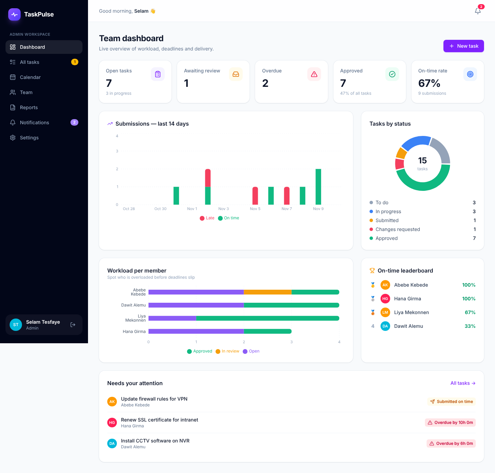
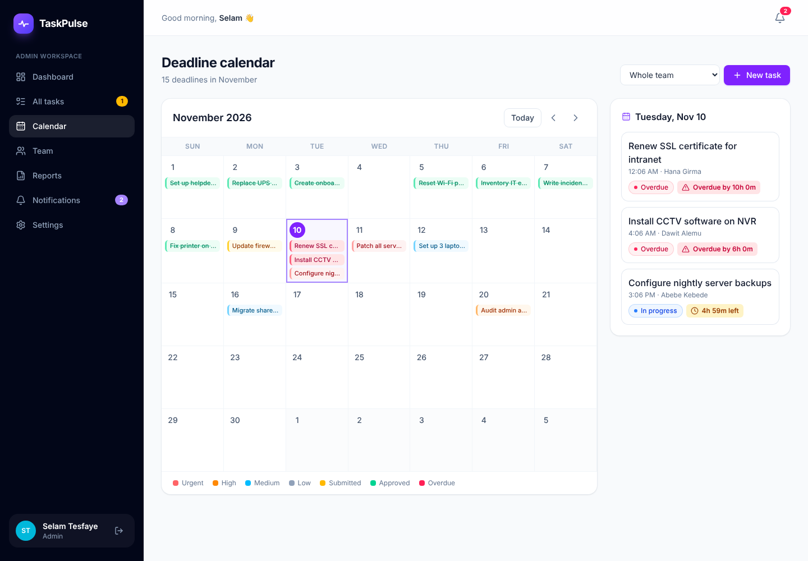
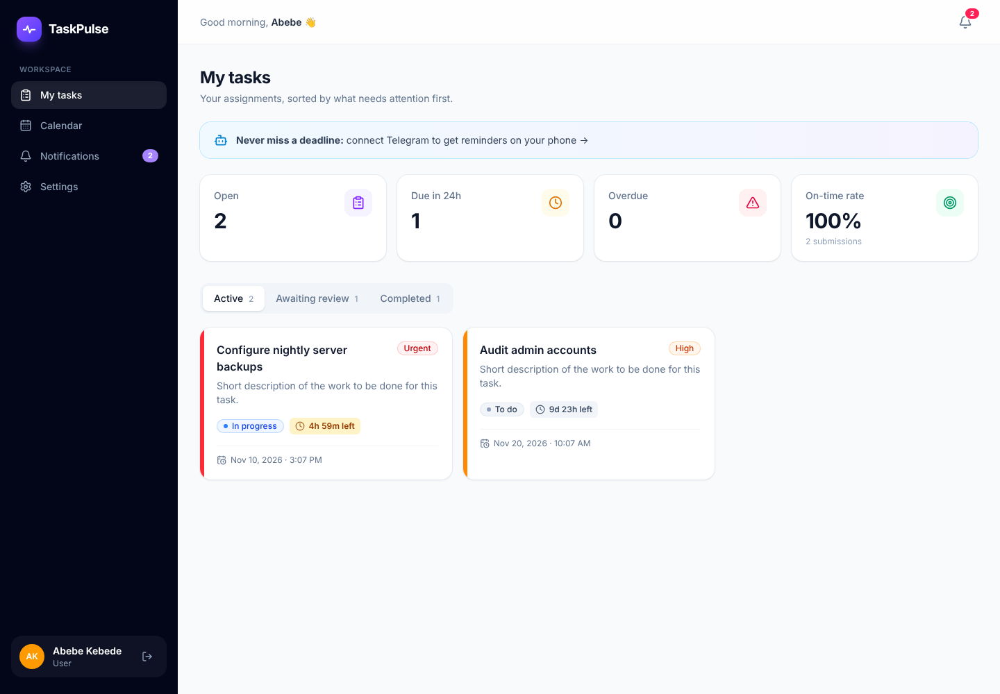
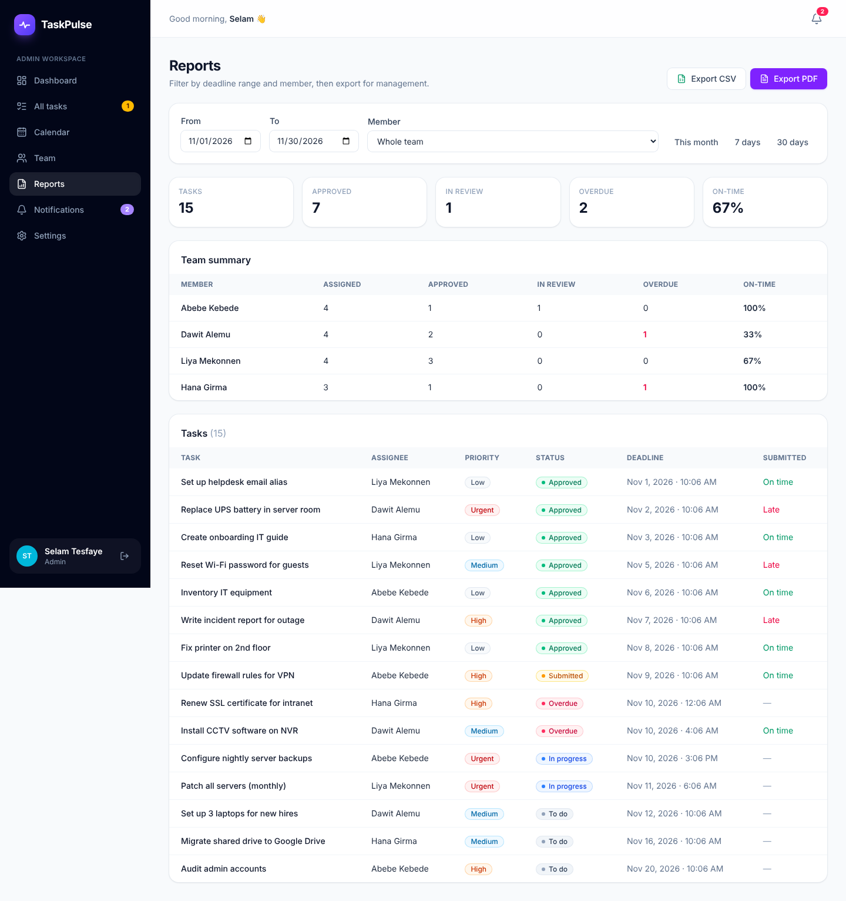

# TaskPulse — Task Management for IT Teams

TaskPulse lets an IT team **assign work, track deadlines live, submit and review tasks**, and keeps everyone notified **in the app and on Telegram**.

**Demo accounts** (after running the seed script) — password for all: `Demo@1234`

| Role | Email |
|---|---|
| Admin | `admin@demo.com` |
| Member | `abebe@demo.com`, `hana@demo.com`, `dawit@demo.com`, `liya@demo.com` |

## 📸 Screenshots

| Admin dashboard | Deadline calendar |
|---|---|
|  |  |
| **Member view** | **Reports** |
|  |  |

---

## ✨ Features

### Core (required)
- **Two roles — Admin and Member**, enforced by **Firestore Security Rules** on Google's servers (not just hidden buttons).
- **Admins** create, edit, assign, reassign and delete tasks with a priority and deadline; review submissions → **Approve** or **Request changes**.
- **Members** see only their own tasks, mark them *In progress* and **submit work** (note + link).
- **Deadlines**: live countdowns (green → amber under 24h → red when overdue). Late submissions are still accepted but **flagged "Late"**.
- **Notifications**: real-time bell with unread count, pop-up toasts, and a notifications page. Triggered by assignment, deadline change, submission, approval/changes requested, comments, 24-hour reminders and overdue alerts.

### Creative extras
1. 🤖 **Telegram bot** — every notification is also sent to Telegram with an "Open task" button. Send `/tasks` to the bot to see your open tasks and deadlines. Automatic daily deadline reminders.
2. 📊 **Analytics dashboard** — KPIs, submissions per day (on-time vs late), tasks by status, workload per member, on-time leaderboard, and a "needs attention" list.
3. 📅 **Deadline calendar** — month view, colour-coded by priority/status, overdue in red, filter by team member, day-detail side panel.
4. 📄 **Reports export** — filter by date range and member, export a branded **PDF** report or a **CSV** (opens correctly in Excel).

### Small touches
Workload warning when assigning (*"Abebe already has 5 open tasks"*), discussion thread on every task, activity timeline, grid/table views with search and filters, mobile-friendly layout, loading/empty/error states.

---

## 🧱 Tech stack

| Layer | Choice | Why |
|---|---|---|
| UI | React 19 + Vite + Tailwind CSS 4 | Fast dev server, small modern setup |
| Auth | Firebase Authentication (email/password) | Secure login without writing a backend |
| Database | Cloud Firestore | **Real-time** listeners → live notifications & dashboard |
| Security | Firestore Security Rules | Role permissions enforced server-side |
| Server code | Vercel Serverless Functions (`/api`) | Holds the Telegram bot token securely |
| Scheduler | Vercel Cron | Daily deadline reminders (free — no Firebase Blaze plan needed) |
| Charts / PDF | Recharts, jsPDF + AutoTable | |

---

## 🚀 Setup — step by step

### Step 1 — Run it on your computer
1. Install **Node.js 20+** from nodejs.org.
2. Unzip the project, open a terminal in the folder and run:
   ```bash
   npm install
   ```

### Step 2 — Create the Firebase project
1. Go to <https://console.firebase.google.com> → **Add project** → name it `taskpulse` (Google Analytics: off).
2. **Build → Authentication → Get started → Email/Password → Enable → Save.**
3. **Build → Firestore Database → Create database** → choose a location (e.g. `europe-west1`) → **Start in production mode**.
4. **Project settings (⚙) → General → Your apps → Web (`</>`)** → register app `taskpulse-web` → copy the `firebaseConfig` values.
5. Copy `.env.example` to a new file named `.env` and paste the values:
   ```
   VITE_FIREBASE_API_KEY=AIza...
   VITE_FIREBASE_AUTH_DOMAIN=taskpulse-xxxx.firebaseapp.com
   VITE_FIREBASE_PROJECT_ID=taskpulse-xxxx
   VITE_FIREBASE_STORAGE_BUCKET=taskpulse-xxxx.appspot.com
   VITE_FIREBASE_MESSAGING_SENDER_ID=...
   VITE_FIREBASE_APP_ID=1:...
   ```

### Step 3 — Publish the security rules
Firestore → **Rules** tab → delete what's there → paste the contents of `firestore.rules` → **Publish**.

*(Or with the CLI: `npm i -g firebase-tools`, `firebase login`, `firebase deploy --only firestore:rules --project <your-project-id>`.)*

### Step 4 — Start the app and make yourself admin
```bash
npm run dev
```
Open <http://localhost:5173>, **create an account**. Every new account is a *member* (the rules forbid making yourself admin — that's the point). To create the first admin:

Firestore → **Data** → `users` → your document → change `role` from `user` to `admin` → refresh the app. From then on, promote people from the **Team** page.

### Step 5 (recommended) — Load demo data
1. Project settings → **Service accounts → Generate new private key** → save the file as `service-account.json` in the project folder. **Never commit or share this file** (it's in `.gitignore`).
2. Run:
   ```bash
   npm run seed
   ```
   This creates 5 demo users and 15 realistic tasks (overdue, submitted late, approved, changes requested…) so every chart and badge shows up in your demo.

### Step 6 — Create the Telegram bot
1. In Telegram, open **@BotFather** → `/newbot` → give it a name (`TaskPulse`) and a username ending in `bot` (e.g. `TaskPulseITBot`).
2. BotFather gives you a **token** like `7123456789:AAH...`. Keep it secret.
3. Optional polish: `/setdescription`, `/setuserpic`, and `/setcommands` →
   ```
   tasks - Show my open tasks
   help - How this bot works
   ```
4. Add to `.env`: `VITE_TELEGRAM_BOT_USERNAME=TaskPulseITBot` (no `@`).

### Step 7 — Deploy to Vercel
1. Push the project to a **GitHub** repository.
2. <https://vercel.com> → **Add New → Project** → import the repo (Vercel detects Vite automatically).
3. **Settings → Environment Variables**, add:

   | Name | Value |
   |---|---|
   | all six `VITE_FIREBASE_…` | same as your `.env` |
   | `VITE_TELEGRAM_BOT_USERNAME` | your bot username |
   | `TELEGRAM_BOT_TOKEN` | token from BotFather |
   | `TELEGRAM_WEBHOOK_SECRET` | any long random string, e.g. `tp_9f8a7c6e5d4b3a21` |
   | `FIREBASE_SERVICE_ACCOUNT` | the **entire** contents of `service-account.json` (paste as-is) |
   | `CRON_SECRET` | another long random string |
   | `APP_URL` | your Vercel URL, e.g. `https://taskpulse.vercel.app` |

4. **Deploy** (or Redeploy after adding variables).
5. Firebase → Authentication → **Settings → Authorized domains → Add** your `xxx.vercel.app` domain.

### Step 8 — Connect the bot to your deployed app (one time)
Open this URL in your browser (replace the 3 values):
```
https://api.telegram.org/bot<TELEGRAM_BOT_TOKEN>/setWebhook?url=<APP_URL>/api/telegram-webhook&secret_token=<TELEGRAM_WEBHOOK_SECRET>
```
You should see `{"ok":true,"result":true,"description":"Webhook was set"}`.

### Step 9 — Test everything
1. Log in as a member → **Settings → Connect Telegram** → press **START** in Telegram → you get "✅ connected".
2. As admin, assign that member a task → the bell updates instantly **and** a Telegram message arrives.
3. Member submits → admin is notified → admin approves → member is notified.
4. Send `/tasks` to the bot.
5. Reports → **Export PDF**.

> **Reminders:** Vercel Cron runs `/api/cron/reminders` daily at 06:00 UTC (09:00 Addis Ababa). The free Hobby plan allows one run per day; on Pro you can change the schedule in `vercel.json` to hourly (`0 * * * *`). To test immediately:
> `curl -H "Authorization: Bearer <CRON_SECRET>" <APP_URL>/api/cron/reminders`

---

## 🗂 Project structure

```
api/                         ← server code (Vercel functions) — has the secrets
  _lib/admin.js              Firebase Admin SDK + helper to notify users
  _lib/telegram.js           send Telegram messages
  notify.js                  POST /api/notify — Telegram copy of a notification
  telegram-webhook.js        Telegram → us: /start linking, /tasks, /help
  cron/reminders.js          daily 24h reminders + overdue alerts
src/
  main.jsx, App.jsx          entry point + routes (admin-only route guard)
  context/AuthContext.jsx    login state + user profile (with role), live
  context/DataContext.jsx    one live copy of tasks, users, notifications
  lib/
    firebase.js              Firebase connection
    constants.js             statuses, priorities, colours
    utils.js                 dates, overdue logic, helpers
    notify.js                in-app + Telegram notification sender
    stats.js                 analytics calculations
    export.js                PDF & CSV generation
  components/                UI kit, TaskCard, TaskForm, Countdown, NotificationBell, Layout
  pages/                     Dashboard, AllTasks, MyTasks, TaskDetail, CalendarPage,
                             Team, Reports, Notifications, Settings, Login, Register
firestore.rules              ← the security model
scripts/seed.mjs             demo data
```

## 🗃 Data model (Firestore)

```
users/{uid}            name, email, role: "admin"|"user", telegramChatId?, telegramLinkCode?
tasks/{id}             title, description, priority, status, deadline,
                       assigneeId, assigneeName, createdBy, createdByName,
                       submission { note, link, submittedAt, isLate },
                       reviewNote, approvedAt, history[ {action, by, byName, at, note} ],
                       reminded24h, overdueNotified
tasks/{id}/comments/{id}   authorId, authorName, text, createdAt
notifications/{id}     userId, fromId, type, title, message, taskId, read, createdAt
```

### Task lifecycle
```
TODO ──► IN PROGRESS ──► SUBMITTED ──► APPROVED ✅
              ▲               │
              └── CHANGES REQUESTED ◄┘
```

---

## 🎤 How it works — talking points for the presentation

**1. Security is on the server.** `firestore.rules` is checked by Google for every read/write. A member *can't* read other people's tasks, *can't* make themselves admin, and can only change `status`, `submission` and `history` on their own task — and only to `in_progress` or `submitted`. Even someone using the browser console can't bypass this.

**2. "Overdue" is calculated, not stored.** `isOverdue = deadline < now && status is still open`. If we stored it, a background job would have to update it constantly and it could be wrong. Calculating it means it's always correct.

**3. Real-time everywhere.** `DataContext` opens Firestore `onSnapshot` listeners once. When an admin assigns a task, the member's bell, task list and the admin's dashboard update instantly — no refresh.

**4. Notifications go two ways.** `lib/notify.js` writes a document to `notifications` (in-app bell) and calls `/api/notify` (Telegram). The Telegram call is fire-and-forget so a Telegram problem never breaks the app.

**5. Secrets never reach the browser.** The bot token and Admin SDK key live only in Vercel environment variables, used by `/api` functions. `/api/notify` verifies the caller's Firebase ID token, and members may only message admins (anti-spam).

**6. Telegram linking without phone numbers.** The app stores a random one-time code on the user's profile and opens `t.me/<bot>?start=<code>`. When the user presses START, Telegram sends that code to our webhook, which finds the user and saves their chat ID. The webhook checks a secret header so only Telegram can call it.

**7. Reminders without paid plans.** Vercel Cron calls `/api/cron/reminders` daily. It sends each 24-hour reminder and overdue alert once (`reminded24h` / `overdueNotified` flags); editing a deadline resets the flags.

**8. Performance.** Dashboard, Calendar, Team and Reports are lazy-loaded, and the PDF library is only downloaded when someone clicks Export.

## Known limitations / next steps
- File uploads use links (Drive/GitHub) because Firebase Storage now requires the paid Blaze plan; adding Storage uploads is a small change.
- PDF reports use a built-in Latin font, so Amharic names won't render in the PDF (CSV handles them fine). Embedding a Ge'ez font (e.g. Noto Sans Ethiopic) would fix this.
- Possible next features: recurring tasks, subtasks checklist, Amharic UI, email notifications.

## Develop offline (optional)
With Java installed: `firebase emulators:start --only auth,firestore --project demo-taskpulse`, set `VITE_USE_EMULATOR=true` plus any dummy `VITE_FIREBASE_*` values with `VITE_FIREBASE_PROJECT_ID=demo-taskpulse`, and seed with
`FIRESTORE_EMULATOR_HOST=127.0.0.1:8080 FIREBASE_AUTH_EMULATOR_HOST=127.0.0.1:9099 npm run seed`.
